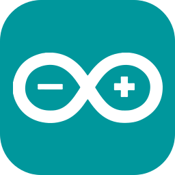
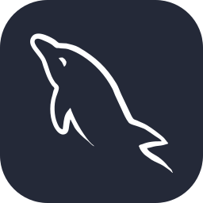
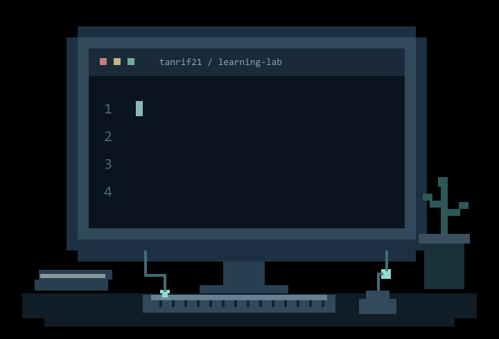
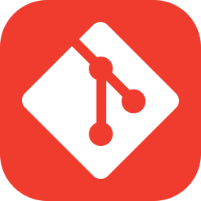

  

<a href="./assets/banner-pixel-cinema-still.png">View still banner</a>

<h1 align="center">Hello 👋, I’m Tanvir Rifat</h1>
<h3 align="center">Web Development · Backend · IoT</h3>

  I build practical web applications and explore connected hardware. 
  Learning through personal projects and team contributions.

  <a href="#projects-to-explore"><strong>Explore my projects</strong></a>
  &nbsp; · &nbsp;
  <a href="https://github.com/pulls?q=is%3Apr+author%3Atanrif21+is%3Amerged"><strong>View my contributions</strong></a>

  
  &nbsp;
  
  &nbsp;
  
  &nbsp;
  
  &nbsp;
  

 

### A little about me

- 💡 I’m curious about how things work—and how to build them.
- 🛠️ I explore ideas through web development and hardware projects.
- 🌱 Every project gives me something new to learn.

 

### Find me online

  
  &nbsp; <a href="https://github.com/tanrif21"><strong>@tanrif21</strong></a>

### Languages & project tools

Technologies used in my projects; contribution details are linked below.

**Web & backend**

  
  
  
  
  

**Databases**

  
  

**Hardware & embedded projects**

  
  &nbsp; <strong>ESP32 · Sensors · I2C</strong>

**Development tools**

  
  

### Projects to explore

| Project | My work / What you’ll find |
| --- | --- |
| [**ThreadFlow**](https://github.com/ash01-forge/ThreadFlow) | **Team contribution:** quality inspection, defect management, rework, packing, shipment, and audit history. [My merged contributions](https://github.com/ash01-forge/ThreadFlow/pulls?q=is%3Apr+is%3Amerged+author%3Atanrif21). |
| [**UIU Textbook Marketplace**](https://github.com/ash01-forge/UIU-Used-Textbook-Marketplace) | **Team contribution:** buyer dashboard, profile and wishlist, purchase requests, messaging, and review APIs. [Implementation](https://github.com/ash01-forge/UIU-Used-Textbook-Marketplace/pull/4) · [Validation fixes](https://github.com/ash01-forge/UIU-Used-Textbook-Marketplace/pull/11). |
| [**Café Journal**](https://github.com/tanrif21/cafe-journal) | Personal café journal with shared treats, searchable history, and monthly reports. **JavaScript · Node.js · PostgreSQL.** |
| [**BlueCycle**](https://github.com/tanrif21/BlueCycle-Smart-Pond-Monitoring-System) | ESP32 and Arduino pond monitoring, automatic control, and a local Wi-Fi dashboard. [My interface contribution](https://github.com/tanrif21/BlueCycle-Smart-Pond-Monitoring-System/pull/1). |

Team contribution details are available in the corresponding repositories and merged pull requests.

### Engineering habits I’m developing

Clear documentation · Practical projects · Careful validation · Honest contribution notes

---

  <strong>Learning steadily. Building with purpose.</strong> 
  <a href="https://github.com/tanrif21">Explore my work and contributions on GitHub.</a>

Original pixel banner and coding illustration prepared for Tanvir. Icons by <a href="https://github.com/tandpfun/skill-icons">Skill Icons</a> — <a href="./SKILL-ICONS-LICENSE.txt">MIT license</a>.
